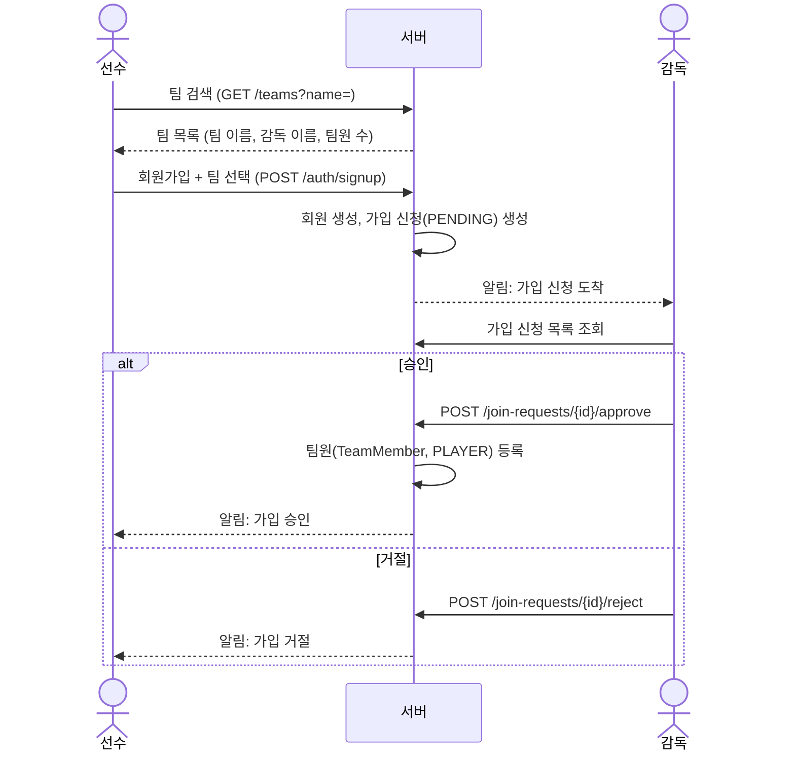

# API 명세 (MVP)

> 기준 문서: `docs/mvp-scope.md`, `docs/erd.md`, `docs/entity-structure.md`
> 구현 후에는 Swagger(springdoc-openapi)로 실제 요청·응답 문서를 제공한다. 이 문서는 **설계와 권한 규칙**을 정리하는 용도다.

## 1. 공통 규칙

### 1-1. 기본 경로
- 모든 API는 `/api/v1`으로 시작한다.

### 1-2. 인증
- 회원가입·로그인·팀 검색을 제외한 모든 API는 로그인이 필요하다.
- 로그인 시 발급받은 토큰을 `Authorization: Bearer {token}` 헤더로 전달한다.
- 토큰 방식(JWT 등)과 만료 정책은 인증 구현 시 확정한다.

### 1-3. 에러 응답 형식
```json
{
  "code": "LINEUP_ALREADY_CONFIRMED",
  "message": "이미 확정된 기록입니다."
}
```

| HTTP 상태 | 의미 |
|---|---|
| 400 Bad Request | 요청 값이 잘못됨 (형식, 범위 등) |
| 401 Unauthorized | 로그인하지 않음 |
| 403 Forbidden | 로그인했지만 권한 없음 (예: 다른 선수 기록 수정) |
| 404 Not Found | 대상이 없음 |
| 409 Conflict | 현재 상태와 충돌 (예: 이미 확정된 기록 수정, 중복 가입 신청) |

### 1-4. 권한 용어
| 용어 | 의미 |
|---|---|
| 누구나 | 로그인하지 않아도 호출 가능 |
| 로그인 | 로그인한 모든 회원 |
| 팀원 | 해당 팀에 승인된 회원 (감독 포함) |
| 감독 | 해당 팀의 `MANAGER` 역할 |
| 본인 | 해당 기록의 주인 (타석의 타자·투수, 득점·도루의 주자) |

<br>

## 2. 엔드포인트 목록

| 구분 | 메서드 · URL | 설명 | 권한 |
|---|---|---|---|
| 인증 | `POST /auth/signup` | 회원가입 (팀 가입 신청 또는 팀 생성 선택 가능) | 누구나 |
| | `POST /auth/login` | 로그인 | 누구나 |
| | `GET /members/me` | 내 정보 및 소속 팀 | 로그인 |
| 팀 | `GET /teams?name=` | 팀 검색 (감독 이름 포함) | 누구나 |
| | `POST /teams` | 팀 생성 (생성자는 감독) | 로그인 |
| | `GET /teams/{teamId}/members` | 팀원 목록 | 팀원 |
| 가입 신청 | `POST /teams/{teamId}/join-requests` | 팀 가입 신청 | 로그인 |
| | `GET /teams/{teamId}/join-requests?status=PENDING` | 가입 신청 목록 | 감독 |
| | `POST /join-requests/{requestId}/approve` | 승인 → 팀원 등록 | 감독 |
| | `POST /join-requests/{requestId}/reject` | 거절 | 감독 |
| | `GET /members/me/join-requests` | 내 가입 신청 상태 | 로그인 |
| 알림 | `GET /notifications` | 내 알림 목록 | 로그인 |
| | `PATCH /notifications/{notificationId}/read` | 알림 읽음 처리 | 본인 |
| 경기 | `POST /teams/{teamId}/games` | 경기 생성 | 감독 |
| | `GET /teams/{teamId}/games` | 경기 목록 | 팀원 |
| | `PATCH /games/{gameId}/finish` | 경기 종료 (종료 이닝 저장) | 감독 |
| 라인업 | `POST /games/{gameId}/lineups` | 출전 선수 등록 | 감독 |
| | `DELETE /lineups/{lineupId}` | 출전 선수 삭제 (기록이 없을 때만) | 감독 |
| 기록 입력 | `POST /games/{gameId}/plate-appearances` | 타석 기록 | 본인, 감독 |
| | `PATCH /plate-appearances/{paId}` | 타석 기록 수정 | 본인, 감독 |
| | `DELETE /plate-appearances/{paId}` | 타석 기록 삭제 | 본인, 감독 |
| | `POST /plate-appearances/{paId}/runs` | 득점 기록 | 주자 본인, 감독 |
| | `DELETE /runs/{runId}` | 득점 기록 삭제 | 주자 본인, 감독 |
| | `POST /games/{gameId}/base-running-events` | 도루·도루실패 기록 | 주자 본인, 감독 |
| 기록 조회 | `GET /games/{gameId}/records` | 경기 전체 기록 (타점·득점 불일치 경고 포함) | 팀원 |
| 확정 | `POST /lineups/{lineupId}/confirm` | 본인 기록 확정 | 본인 |
| | `DELETE /lineups/{lineupId}/confirm` | 확정 해제 | 감독 |
| 지표 | `GET /teams/{teamId}/stats` | 팀 선수별 클래식·세이버 지표 | 팀원 |

> 표의 URL은 `/api/v1`을 생략했다.

<br>

## 3. 팀 가입 흐름



### 규칙
- 회원가입 시 팀은 **선택 사항**이다. 세 가지 중 하나를 고른다.
    1. 기존 팀에 가입 신청 (`joinTeamId`)
    2. 새 팀 생성 후 본인이 감독이 됨 (`newTeamName`)
    3. 팀 없이 가입 후 나중에 신청·생성
- 회원가입 이후에도 `POST /teams/{teamId}/join-requests`로 다른 팀에 추가 신청할 수 있다.
- 같은 팀에 대기 중(`PENDING`)인 신청이 이미 있거나 이미 팀원이면 신청할 수 없다. (409)
- 가입 신청 알림은 해당 팀의 **모든 감독**에게 보낸다.
- 거절된 신청은 기록으로 남기며, 이후 다시 신청할 수 있다.

<br>

## 4. 상세 명세

### 4-1. 회원가입
`POST /api/v1/auth/signup` · 누구나

**Request**
```json
{
  "email": "player@example.com",
  "password": "password123!",
  "name": "박주호",
  "joinTeamId": 3,
  "newTeamName": null
}
```
- `joinTeamId`와 `newTeamName`은 둘 다 비워도 되지만, **동시에 입력할 수 없다.** (400)

**Response** `201 Created`
```json
{
  "memberId": 12,
  "joinRequest": { "requestId": 7, "teamId": 3, "teamName": "썬더스", "status": "PENDING" },
  "createdTeam": null
}
```

| 에러 | 상황 |
|---|---|
| 400 `INVALID_TEAM_OPTION` | `joinTeamId`, `newTeamName` 동시 입력 |
| 404 `TEAM_NOT_FOUND` | 존재하지 않는 팀 |
| 409 `DUPLICATE_EMAIL` | 이미 가입된 이메일 |

### 4-2. 팀 검색
`GET /api/v1/teams?name=썬더` · 누구나

**Response** `200 OK`
```json
[
  { "teamId": 3, "teamName": "썬더스", "managerNames": ["김감독"], "memberCount": 18 },
  { "teamId": 9, "teamName": "썬더볼트", "managerNames": ["이감독", "최감독"], "memberCount": 11 }
]
```
- 이름이 같은 팀을 구분할 수 있도록 **감독 이름**을 함께 보여준다.
- 로그인 없이 호출되므로 이메일 등 개인정보는 포함하지 않는다.

### 4-3. 가입 신청 승인
`POST /api/v1/join-requests/{requestId}/approve` · 감독

**Response** `200 OK`
```json
{ "requestId": 7, "status": "APPROVED", "teamMemberId": 31 }
```
- 신청자를 `PLAYER` 역할 팀원으로 등록하고, 신청자에게 승인 알림을 보낸다.

| 에러 | 상황 |
|---|---|
| 403 `NOT_TEAM_MANAGER` | 해당 팀 감독이 아님 |
| 409 `JOIN_REQUEST_ALREADY_PROCESSED` | 이미 승인·거절된 신청 |

### 4-4. 알림 목록
`GET /api/v1/notifications` · 로그인

**Response** `200 OK`
```json
[
  {
    "notificationId": 41,
    "type": "JOIN_APPROVED",
    "message": "썬더스 가입이 승인되었습니다.",
    "read": false,
    "createdAt": "2026-11-03T10:15:00Z"
  }
]
```

| 알림 유형 | 받는 사람 | 발생 시점 |
|---|---|---|
| `JOIN_REQUESTED` | 해당 팀 감독 전원 | 가입 신청 생성 |
| `JOIN_APPROVED` | 신청자 | 승인 |
| `JOIN_REJECTED` | 신청자 | 거절 |

### 4-5. 경기 생성
`POST /api/v1/teams/{teamId}/games` · 감독

**Request**
```json
{ "opponentName": "레드삭스", "playedAt": "2026-11-08T09:00:00+09:00" }
```

**Response** `201 Created`
```json
{ "gameId": 5, "status": "IN_PROGRESS", "regulationInnings": 9 }
```

### 4-6. 경기 종료
`PATCH /api/v1/games/{gameId}/finish` · 감독

**Request**
```json
{ "endedInning": 7 }
```
- 종료 이닝은 1~12 사이 (400 `INVALID_INNING`)
- 조기 종료 시 미진행 이닝은 기록하지 않으며, 종료 이닝만 저장한다.

### 4-7. 출전 선수 등록
`POST /api/v1/games/{gameId}/lineups` · 감독

**Request**
```json
{ "teamMemberId": 31, "battingOrder": 1, "position": "SS" }
```
- 투수로만 출전하면 `battingOrder`는 `null`
- 같은 경기에 같은 선수를 두 번 등록할 수 없다. (409)

### 4-8. 타석 기록
`POST /api/v1/games/{gameId}/plate-appearances` · 본인, 감독

**Request (우리 팀 공격)**
```json
{
  "offense": true,
  "inning": 3,
  "batterLineupId": 21,
  "resultCode": "2B",
  "rbi": 1,
  "outsRecorded": 0
}
```

**Request (우리 팀 수비)**
```json
{
  "offense": false,
  "inning": 4,
  "pitcherLineupId": 25,
  "resultCode": "SO",
  "outsRecorded": 1,
  "runsAllowed": 0,
  "earnedRuns": 0
}
```

**Response** `201 Created`
```json
{ "plateAppearanceId": 88, "sequence": 17 }
```

- `sequence`(경기 내 타석 순서)는 서버가 자동으로 부여한다.
- `resultCode`는 `docs/record-spec.md`의 타석 결과 코드를 사용한다.

| 에러 | 상황 |
|---|---|
| 403 `NOT_RECORD_OWNER` | 일반 회원이 다른 선수의 타석을 입력 |
| 409 `LINEUP_ALREADY_CONFIRMED` | 해당 선수 기록이 이미 확정됨 |
| 409 `GAME_FINISHED` | 종료된 경기 (감독 제외) |
| 400 `INVALID_EARNED_RUNS` | 자책점 > 실점 |

### 4-9. 득점 기록
`POST /api/v1/plate-appearances/{paId}/runs` · 주자 본인, 감독

**Request**
```json
{ "runnerLineupId": 22 }
```
- 주자 본인이 "어느 타석에서 득점했는지"를 선택해 입력한다.
- 한 선수의 입력이 다른 선수의 기록을 변경하지 않는다.

### 4-10. 경기 전체 기록 조회
`GET /api/v1/games/{gameId}/records` · 팀원

**Response** `200 OK` (요약)
```json
{
  "gameId": 5,
  "status": "IN_PROGRESS",
  "plateAppearances": [ { "paId": 88, "inning": 3, "offense": true, "batterName": "박주호", "resultCode": "2B", "rbi": 1 } ],
  "players": [ { "lineupId": 21, "name": "박주호", "confirmed": false } ],
  "warnings": [
    { "code": "RBI_RUN_MISMATCH", "message": "타점 합계(5)와 득점 합계(4)가 다릅니다. 실책·폭투 등에 의한 득점인지 확인하세요." }
  ]
}
```
- 타점과 득점 합계가 다르면 경고를 포함한다. 실책·폭투 득점이 있을 수 있으므로 **경고만 표시하고 저장은 막지 않는다.**

### 4-11. 기록 확정 / 확정 해제
- `POST /api/v1/lineups/{lineupId}/confirm` · 본인
    - 이미 확정된 기록이면 409 `LINEUP_ALREADY_CONFIRMED`
- `DELETE /api/v1/lineups/{lineupId}/confirm` · 감독
    - 확정·해제 모두 `record_history`에 이력을 남긴다.

### 4-12. 팀 지표
`GET /api/v1/teams/{teamId}/stats?minPlateAppearances=10` · 팀원

**Response** `200 OK` (요약)
```json
[
  {
    "teamMemberId": 31,
    "name": "박주호",
    "plateAppearances": 42,
    "classic": { "avg": 0.324, "obp": 0.405, "slg": 0.486, "ops": 0.891 },
    "sabermetrics": { "iso": 0.162, "babip": 0.351, "wOBA": 0.389 },
    "smallSample": false
  }
]
```
- 최소 타석 기준에 미달하면 `smallSample: true`로 표시한다.
- 투수 지표(ERA, WHIP, FIP 등)는 같은 방식으로 별도 필드에 포함한다.

<br>

## 5. 권한 판단 기준 (서버 로직)

| 대상 | 판단 방법 |
|---|---|
| 팀원 | 로그인한 회원이 해당 팀의 `team_member`에 있는지 |
| 감독 | 해당 `team_member`의 역할이 `MANAGER`인지 |
| 본인 (타석) | 공격이면 `batter_lineup`, 수비면 `pitcher_lineup` → `team_member` → `member`가 로그인한 회원인지 |
| 본인 (득점·도루) | 주자 `lineup` → `team_member` → `member`가 로그인한 회원인지 |
| 수정 가능 여부 | 해당 선수 `lineup.confirmed_at`이 비어 있는지 (감독도 확정 해제 후 수정) |

<br>

## 6. DB 변경 필요 사항 (V2 마이그레이션)

가입 신청과 알림 기능을 위해 테이블 2개를 추가한다.

### team_join_request
| 컬럼 | 설명 |
|---|---|
| id | PK |
| team_id | 신청 대상 팀 |
| member_id | 신청자 |
| status | `PENDING` / `APPROVED` / `REJECTED` |
| processed_by | 처리한 감독 (member) |
| processed_at | 처리 시각 |
| created_at, updated_at | 생성·수정 시각 |

- 같은 팀·회원에 `PENDING` 상태는 하나만 존재 (부분 UNIQUE 인덱스)

### notification
| 컬럼 | 설명 |
|---|---|
| id | PK |
| receiver_id | 받는 회원 |
| type | `JOIN_REQUESTED` / `JOIN_APPROVED` / `JOIN_REJECTED` |
| message | 알림 문구 |
| related_id | 관련 대상 id (가입 신청 id 등) |
| read_at | 읽은 시각 (NULL = 안 읽음) |
| created_at | 생성 시각 |

<br>

## 7. MVP 이후 고려 사항
- 이메일·푸시 알림
- AI 능력 평가 리포트 API
- 팀 탈퇴, 감독 권한 위임
- 경기 목록 페이지네이션