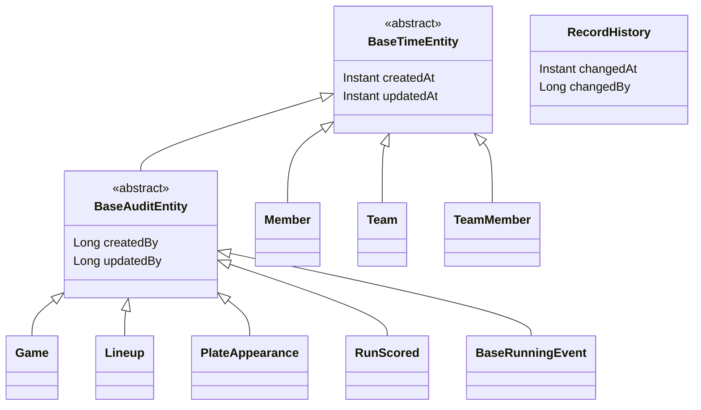
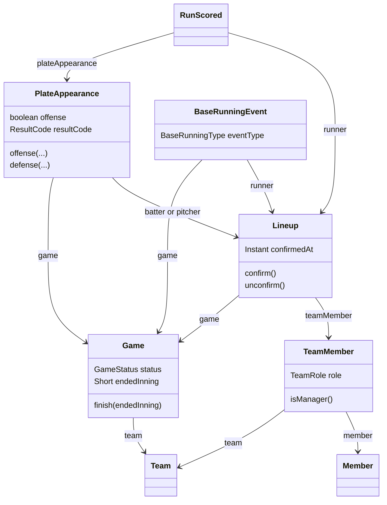

# 엔티티 구조

> 기준: `backend/src/main/java/io/github/jooho2075/statrecord`
> 관련 문서: `docs/erd.md` (테이블 설계), `V1__init.sql` (스키마)

## 1. 패키지 구조

```
io.github.jooho2075.statrecord
├── global
│   ├── config      # JpaAuditingConfig
│   └── entity      # BaseTimeEntity, BaseAuditEntity
├── member/domain   # Member
├── team/domain     # Team, TeamMember, TeamRole
├── game/domain     # Game, Lineup, PlateAppearance, RunScored, BaseRunningEvent
│                   # GameStatus, ResultCode, ResultCodeConverter, BaseRunningType
└── history/domain  # RecordHistory, HistoryAction
```

- 도메인(업무 개념)별로 패키지를 나눈다.
- 이후 Repository, Service, Controller도 각 도메인 패키지 안에 추가한다.

<br>

## 2. 상속 구조



| 부모 클래스 | 제공 필드 | 상속하는 엔티티 | 이유 |
|---|---|---|---|
| `BaseTimeEntity` | 생성 시각, 수정 시각 | `Member`, `Team`, `TeamMember` | 모든 데이터에 생성·수정 시점이 필요 |
| `BaseAuditEntity` | + 작성자, 수정자 | `Game`, `Lineup`, `PlateAppearance`, `RunScored`, `BaseRunningEvent` | 경기 기록은 "누가 입력·수정했는지"가 권한 확인과 이력 관리에 필요 |
| (상속 없음) | 자체 시각·작성자 | `RecordHistory` | 한 번 저장하면 수정하지 않는 기록이라 수정 시각·수정자가 필요 없음 |

- 시각·작성자 값은 JPA Auditing(`@CreatedDate`, `@CreatedBy` 등)으로 저장 시 자동으로 채워진다.
- 작성자 정보(`AuditorAware`)는 현재 비어 있으며, Spring Security 도입 후 로그인한 회원 id를 반환하도록 연결할 예정이다.

<br>

## 3. 연관관계



화살표는 `@ManyToOne` 참조 방향을 나타낸다. 모든 연관관계는 단방향이며 `FetchType.LAZY`를 사용한다.

### 읽는 순서: 회원·팀 → 경기 → 라인업 → 기록

1. **회원·팀:** `TeamMember`가 `Member`와 `Team`을 연결하고, 팀 안에서의 역할(감독 / 일반 회원)을 가진다. 한 회원이 여러 팀에 소속될 수 있다.
2. **경기:** `Game`은 우리 팀(`Team`)의 경기 하나를 나타낸다. 상대 팀은 이름만 저장한다.
3. **라인업:** `Lineup`은 "어느 경기에 어느 팀원이 출전했는지"를 나타낸다. 선수별 기록 확정 여부(`confirmedAt`)도 여기에 저장한다.
4. **기록:** 타석(`PlateAppearance`), 득점(`RunScored`), 도루(`BaseRunningEvent`)는 모두 회원이 아니라 **라인업**을 참조한다.

### 핵심 설계: 기록은 라인업을 참조한다

기록이 `Member`가 아닌 `Lineup`을 참조하도록 설계한 이유는 다음과 같다.

- **경기와 선수가 한 번에 정해진다.** 라인업 하나로 "어느 경기의 어느 선수 기록인지"를 알 수 있다.
- **출전하지 않은 선수의 기록이 생길 수 없다.** 기록을 남기려면 먼저 그 경기 라인업에 등록되어 있어야 한다.
- **권한 확인이 단순해진다.** "본인 기록만 입력"은 기록의 라인업 → 팀원 → 회원이 로그인한 회원과 같은지로 판단하고, "확정된 기록은 수정 불가"는 해당 라인업의 `confirmedAt`으로 판단한다.

<br>

## 4. 엔티티에 담긴 도메인 규칙

| 메서드 | 규칙 |
|---|---|
| `Game.finish(endedInning)` | 종료 이닝은 1~12 사이여야 하며, 호출 시 경기 상태가 `FINISHED`로 바뀐다. |
| `Lineup.confirm()` | 이미 확정된 기록은 다시 확정할 수 없다. |
| `Lineup.unconfirm()` | 확정을 해제한다. 감독만 가능하다는 권한 확인은 서비스 계층에서 한다. |
| `PlateAppearance.offense(...)` | 우리 팀 공격 타석. 타자만 지정하고, 실점·자책점은 0으로 저장한다. |
| `PlateAppearance.defense(...)` | 우리 팀 수비 타석. 투수만 지정하고, 자책점이 실점보다 크면 예외가 발생한다. |
| `TeamMember.isManager()` | 감독 여부를 반환한다. |

- **규칙은 엔티티에, 권한은 서비스에** 둔다. 값의 범위나 상태 변경처럼 객체 스스로 판단할 수 있는 규칙은 엔티티 메서드에 두고, 로그인 사용자 정보가 필요한 권한 확인은 서비스 계층에서 처리한다.
- 공격·수비 타석 생성 메서드를 분리해, DB의 "공격이면 타자만, 수비면 투수만" 제약을 코드에서도 잘못 만들 수 없게 했다.

<br>

## 5. 구현 규칙

| 항목 | 규칙 | 이유 |
|---|---|---|
| 생성 방식 | 기본 생성자는 `protected`, 객체는 정적 메서드(`create`, `offense` 등)로만 생성 | 필수 값이 빠진 객체가 만들어지지 않도록 하기 위함 |
| Setter | 사용하지 않음 | 값 변경은 `finish()`, `confirm()`처럼 의미 있는 메서드로만 허용 |
| 연관관계 | 모두 `@ManyToOne(fetch = LAZY)` | 기본값(EAGER)은 불필요한 조회 쿼리를 발생시킴 |
| `SMALLINT` 컬럼 | `Short` | `ddl-auto: validate`가 타입 불일치를 검사함 |
| `TIMESTAMPTZ` 컬럼 | `Instant` | 시간대 정보를 포함한 시각과 대응 |
| 타석 결과 코드 | `ResultCode` enum + `ResultCodeConverter` | `1B`, `2B`는 숫자로 시작해 enum 이름으로 쓸 수 없으므로 DB 값과 별도 매핑 |
| `jsonb` 컬럼 | `@JdbcTypeCode(SqlTypes.JSON)` | 수정 전·후 데이터를 JSON 문자열로 저장 |