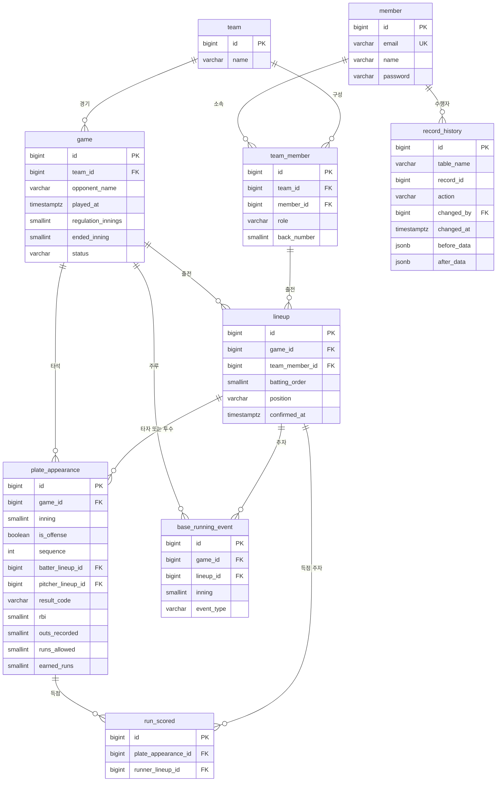

# ERD 설계

> 기준 문서: `docs/record-spec.md`, `docs/mvp-scope.md`
> DB: PostgreSQL

## 1. 관계도

## 2. 테이블 상세

공통: 모든 테이블은 `created_at`, `updated_at` (timestamptz)을 가진다. 기록 테이블은 `created_by`, `updated_by` (member.id)를 추가로 가진다.

### member (회원)
| 컬럼 | 타입 | 제약 | 설명 |
|---|---|---|---|
| id | bigserial | PK | |
| email | varchar(255) | UNIQUE, NOT NULL | 로그인 이메일 |
| name | varchar(50) | NOT NULL | 이름 |
| password | varchar(255) | NOT NULL | 암호화된 비밀번호 |

### team (팀)
| 컬럼 | 타입 | 제약 | 설명 |
|---|---|---|---|
| id | bigserial | PK | |
| name | varchar(100) | NOT NULL | 팀 이름 |

### team_member (팀 소속)
| 컬럼 | 타입 | 제약 | 설명 |
|---|---|---|---|
| id | bigserial | PK | |
| team_id | bigint | FK → team, NOT NULL | |
| member_id | bigint | FK → member, NOT NULL | |
| role | varchar(20) | NOT NULL | `MANAGER`(감독) / `PLAYER`(일반 회원) |
| back_number | smallint | NULL | 등번호 |

- UNIQUE (team_id, member_id)

### game (경기)
| 컬럼 | 타입 | 제약 | 설명 |
|---|---|---|---|
| id | bigserial | PK | |
| team_id | bigint | FK → team, NOT NULL | 우리 팀 |
| opponent_name | varchar(100) | NOT NULL | 상대 팀 이름 |
| played_at | timestamptz | NOT NULL | 경기 일시 |
| regulation_innings | smallint | NOT NULL, DEFAULT 9 | 정규 이닝 |
| ended_inning | smallint | NULL, CHECK 1~12 | 실제 종료 이닝 |
| status | varchar(20) | NOT NULL | `IN_PROGRESS`(진행 중) / `FINISHED`(종료) |

### lineup (경기별 출전 선수)
| 컬럼 | 타입 | 제약 | 설명 |
|---|---|---|---|
| id | bigserial | PK | |
| game_id | bigint | FK → game, NOT NULL | |
| team_member_id | bigint | FK → team_member, NOT NULL | |
| batting_order | smallint | NULL | 타순 (투수 전용 출전 시 NULL) |
| position | varchar(10) | NULL | 포지션 |
| confirmed_at | timestamptz | NULL | 기록 확정 시각 (NULL = 미확정) |

- UNIQUE (game_id, team_member_id)
- 확정 해제 시 `confirmed_at`을 NULL로 변경

### plate_appearance (타석)
| 컬럼 | 타입 | 제약 | 설명 |
|---|---|---|---|
| id | bigserial | PK | |
| game_id | bigint | FK → game, NOT NULL | |
| inning | smallint | NOT NULL, CHECK 1~12 | 이닝 |
| is_offense | boolean | NOT NULL | true = 우리 팀 공격, false = 수비 |
| sequence | int | NOT NULL | 경기 내 타석 순서 |
| batter_lineup_id | bigint | FK → lineup, NULL | 우리 팀 타자 (공격 시) |
| pitcher_lineup_id | bigint | FK → lineup, NULL | 우리 팀 투수 (수비 시) |
| result_code | varchar(5) | NOT NULL | `record-spec.md`의 타석 결과 코드 |
| rbi | smallint | NOT NULL, DEFAULT 0 | 타점 (공격 시) |
| outs_recorded | smallint | NOT NULL, DEFAULT 0 | 이 타석에서 발생한 아웃 수 |
| runs_allowed | smallint | NOT NULL, DEFAULT 0 | 실점 (수비 시) |
| earned_runs | smallint | NOT NULL, DEFAULT 0 | 자책점 (수비 시) |

- CHECK: `is_offense = true`이면 batter_lineup_id NOT NULL, pitcher_lineup_id NULL
- CHECK: `is_offense = false`이면 pitcher_lineup_id NOT NULL, batter_lineup_id NULL
- UNIQUE (game_id, sequence)

### run_scored (우리 팀 득점)
| 컬럼 | 타입 | 제약 | 설명 |
|---|---|---|---|
| id | bigserial | PK | |
| plate_appearance_id | bigint | FK → plate_appearance, NOT NULL | 득점이 발생한 타석 |
| runner_lineup_id | bigint | FK → lineup, NOT NULL | 득점한 주자 |

- UNIQUE (plate_appearance_id, runner_lineup_id)
- 득점한 주자 본인이 입력

### base_running_event (도루·도루실패)
| 컬럼 | 타입 | 제약 | 설명 |
|---|---|---|---|
| id | bigserial | PK | |
| game_id | bigint | FK → game, NOT NULL | |
| lineup_id | bigint | FK → lineup, NOT NULL | 주자 |
| inning | smallint | NOT NULL, CHECK 1~12 | |
| event_type | varchar(10) | NOT NULL | `SB`(도루) / `CS`(도루실패) |

### record_history (수정 이력)
| 컬럼 | 타입 | 제약 | 설명 |
|---|---|---|---|
| id | bigserial | PK | |
| table_name | varchar(50) | NOT NULL | 대상 테이블 |
| record_id | bigint | NOT NULL | 대상 레코드 id |
| action | varchar(20) | NOT NULL | `CREATE` / `UPDATE` / `DELETE` / `CONFIRM` / `UNCONFIRM` |
| changed_by | bigint | FK → member, NOT NULL | 수행자 |
| changed_at | timestamptz | NOT NULL | 수행 시각 |
| before_data | jsonb | NULL | 변경 전 값 |
| after_data | jsonb | NULL | 변경 후 값 |

## 3. 권한 판단 기준 (서버 로직)
| 대상 | 입력·수정 가능한 사람 |
|---|---|
| 공격 타석 | 해당 타자 본인, 감독 |
| 수비 타석 | 해당 투수 본인, 감독 |
| 득점 | 득점한 주자 본인, 감독 |
| 도루·도루실패 | 해당 주자 본인, 감독 |

- 해당 선수의 `lineup.confirmed_at`이 있으면 본인도 수정 불가
- 확정 해제는 감독만 가능

## 4. 계산 방식
- 투구 이닝 = 해당 투수 수비 타석의 `outs_recorded` 합계
- 피안타·볼넷·삼진·피홈런 = 해당 투수 수비 타석의 `result_code`로 계산
- 득점 = `run_scored` 건수
- 지표 계산식은 `docs/record-spec.md` 참고